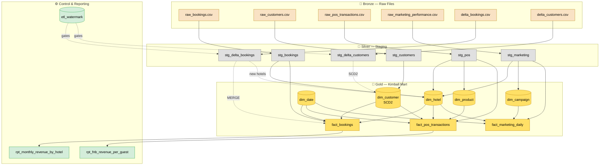

<div align="center">

# 🏨 Hotel Data Pipeline

**A local DuckDB + Python pipeline that cleans dirty hospitality data into a Kimball data mart and keeps it fresh incrementally.**

[](https://www.python.org/)
[](https://duckdb.org/)


</div>

---

## 📖 Table of Contents

- [Overview](#-overview)
- [Architecture](#-architecture)
- [Quick Start](#-quick-start)
- [Project Structure](#-project-structure)
- [Part 1 — Staging Layer](#-part-1--staging-layer)
- [Part 2 — Kimball Data Mart](#-part-2--kimball-data-mart)
- [Part 3 — Incremental Load](#-part-3--incremental-load)
- [Part 4 — Written Answers](#-part-4--written-answers)
- [Bonus Tables](#-bonus-tables)
- [Key Design Decisions](#-key-design-decisions)
- [Known Limitations](#-known-limitations)
- [Tech Stack](#-tech-stack)

---

## 🎯 Overview

Three source systems feed this pipeline:

| Source | File | Rows |
|---|---|---|
| **PMS** | `raw_bookings.csv` | 3200 |
| **CRM** | `raw_customers.csv` | 850 |
| **POS** | `raw_pos_transactions.csv` | 12000 |
| **Marketing** | `raw_marketing_performance.csv` | 1600 |

Plus two daily deltas (`delta_bookings_2024-04-01.csv`, `delta_customers_2024-04-01.csv`)

The pipeline:
1. **Cleans** each source into a staging layer.
2. **Models** a Kimball star schema (`dim_*` + `fact_*`).
3. **Merges** deltas incrementally — no full overwrites.
4. **Proves** idempotency via a built-in test.

---

## 🏗 Architecture



---

## 🚀 Quick Start

```bash
# 1. Clone
git clone <this-repo-url>
cd hotel-data-pipeline

# 2. Install dependencies
pip install duckdb pandas

# 3 Run
python pipeline.py all

# 4 Read data table with database management tool
#In this case I'm using dbeaver to read the data tables.


```

### Available commands

| Command | Description |
|---|---|
| `python pipeline.py init` | Full initial load: staging → dims → facts |
| `python pipeline.py delta` | Incremental load of the two delta files |
| `python pipeline.py test` | Idempotency proof (runs delta twice, compares) |
| `python pipeline.py all` | `init` → `delta` → `test` |

### Expected output

```
This result shown in terminal after run 'python pipeline.py all' which shows the total rows of specific tables before and after incremental load. Also performed idempotencty test to ensure result remain the same after another incremental load.

== INITIAL LOAD ==
{'fact_bookings': 3200, 'fact_pos_transactions': 11719, 'fact_marketing_daily': 1598, 'dim_customer': 800, 'dim_customer (Iscurrent = True)': 800}
== INCREMENTAL LOAD ==
fact_bookings new rows: 50 | dim_customer new versions: 13
{'fact_bookings': 3250, 'fact_pos_transactions': 11719, 'fact_marketing_daily': 1598, 'dim_customer': 813, 'dim_customer (Iscurrent = True)': 806}
== IDEMPOTENCY TEST ==
before: {'fact_bookings': 3250, 'fact_pos_transactions': 11719, 'fact_marketing_daily': 1598, 'dim_customer': 813, 'dim_customer (Iscurrent = True)': 806}
after : {'fact_bookings': 3250, 'fact_pos_transactions': 11719, 'fact_marketing_daily': 1598, 'dim_customer': 813, 'dim_customer (Iscurrent = True)': 806}
IDEMPOTENT ✔
```

---

## 📂 Project Structure

```
hotel-data-pipeline/
├── pipeline.py                    # entire pipeline (single file)
├── README.md
├── mart.duckdb                    # generated output
└── data/
    ├── raw/
    │   ├── raw_bookings.csv
    │   ├── raw_customers.csv
    │   ├── raw_pos_transactions.csv
    │   └── raw_marketing_performance.csv
    └── delta/
        ├── delta_bookings_2024-04-01.csv
        └── delta_customers_2024-04-01.csv
```

---

## 🥈 Part 1 — Staging Layer

<details open>
<summary><b>Click to expand: cleaning rules</b></summary>

### Column & date standardisation

| Rule | Implementation |
|---|---|
| Column names | Lowercased, non-alphanumerics stripped, mapped via `BOOKING_COLS` / `CUSTOMER_COLS` / `POS_COLS` / `MARKETING_COLS` |
| Dates | `parse_date` macro tries ISO, `DD/MM/YYYY`, `DD Mon YYYY`, `DD-Mon-YYYY`. All DATE columns use the ISO 8601 format YYYY-MM-DD. All TIMESTAMP columns use YYYY-MM-DD HH:MM:SS (naive, no timezone suffix) the session timezone is set to Asia/Jakarta so CURRENT_TIMESTAMP values reflect Jakarta wall clock.|
| Timestamps | `parse_ts` macro tries ISO, `T`-separated, minute-precision|
| POS amounts | `money()` macro strips `IDR` / `Rp` and commas, casts to `DOUBLE` |

### Normalisation

| Field | Values |
|---|---|
| `booking_status` Title-cased | Confirmed · Checked-In · Checked-Out · Cancelled · No-Show · Completed · NULL|
| `is_loyalty_member` | `TRUE` / `FALSE` / `NULL` |
| `payment_method` Title-cased | Cash · Credit Card · GoPay · OVO · QRIS · Dana · Null|
| `category` | Food · Beverage · Spa · Retail · Null |
| `item_name` | Title-cased with misspelling repair (`kopi` → Coffee, `coctail` → Cocktail) |
| `email` | Lowercased, whitespace stripped, missing `@` repaired when provider domain is known |

### Data quality flags

| Flag | Action |
|---|---|
| `dq_missing_pk` | ❌ **Row dropped** — cannot be merged |
| `dq_bad_date` | ⚠️ Flagged; check-in or check-out date becomes NULL |
| `dq_negative_stay` | ⚠️ Flagged; nights preserved from source |
| `dq_missing_revenue` | ⚠️ Flagged; total_revenue_idr becomes NULL |
| `dq_bad_email` | ⚠️ Flagged; email is null or has domain, value kept for audit |
| `dq_missing_hotel` | ⚠️ Flagged: hotel_name is NULL |
| `dq_flag` | ⚠️ Flagged: pos_transaction_id or transaction_date or customer_id is null |

### Deduplication

**stg_bookings:** Get latest data `booking_id` data from `raw_bookings.csv` based on `source_updated_at`.
- Origin total row = 3200
- Total row after dedup = 3200

**stg_customers:** Get latest data `customer_id` data from `raw_customers.csv` based on `source_updated_at`.
- Example case: for customer 'CUST00774'
- Origin total row = 850
- Total row after dedup = 800

**stg_marketing:** Get latest data `campaign_name, platform, ad_creative_id,target_audience, date, hotel_name` data from `raw_marketing_performance` based on `row_id`.
- Example case:
  campaign_name = 'Valentine Weekend'
  AND platform = 'Email Campaign'
  AND ad_creative_id IS NULL
  AND target_audience = 'Lookalike'
  AND hotel_name = 'Alaya Ubud'
- Origin total row = 1600
- Total row after dedup = 1598

**stg_pos:** Get data `pos_transaction_id` data from `raw_pos_transactions.csv`
- Example Case: pos_transaction_id = 'POS-003626'
- Origin total row = 12059
- Total row after dedup = 11719

</details>

---

## 🥇 Part 2 — Kimball Data Mart

### SCD Type decisions

<table>
<tr><th>Attribute</th><th>Type</th><th>Reason</th></tr>
<tr><td><code>loyalty_tier</code></td><td><b>2</b></td><td>Drives loyalty reporting — history required</td></tr>
<tr><td><code>full_name</code>, <code>email</code>, <code>phone</code>, <code>city</code>, <code>nationality</code></td><td>1</td><td>Contact attributes — only current value matters</td></tr>
<tr><td><code>joined_date</code></td><td>1</td><td>Corrections should overwrite</td></tr>
</table>

### Booking → customer link

Each booking links to the `dim_customer` version valid at **booking time** (`source_created_at`, falling back to `check_in_date`).

### Null-handling strategy

| Situation | Treatment |
|---|---|
| No primary key | Drop |
| Empty string after trim | Store `NULL` |
| Null numeric measure | Store `NULL` (`SUM()` ignores) |
| Null date | Most Store `NULL` |
| Null `customer_id` in POS | `customer_sk = 0` |

---

## ⚡ Part 3 — Incremental Load

### 🔖 Watermark

Stored in `etl_watermark`, seeded at `2024-03-28 00:00:00`. 

1. Before processing a delta, read the last watermark.
2. Filter the delta: keep only rows WHERE source_updated_at >= watermark.
3. Process those rows (MERGE into facts, SCD2 into dims).
4. After processing, move the watermark forward to the newest source_updated_at seen.

### 🔀 MERGE

```sql
MERGE INTO fact_bookings AS t
USING (SELECT ... FROM stg_delta_bookings) AS s
ON t.booking_id = s.booking_id
WHEN MATCHED AND s.source_updated_at > t.source_updated_at
    THEN UPDATE SET ...
WHEN NOT MATCHED THEN INSERT ...
```

### 🔁 SCD2 in merge

1. Close old version

If a customer's loyalty tier changed, mark their current row as historical: set valid_to to the change time and flip is_current to FALSE. The old row stays — that's the history.

2. Open new version

If a customer no longer has a current row (because step 1 just closed it, or because they're brand new), insert a fresh row with is_current = TRUE. Its surrogate key is different from the old one, because it represents a different version of the same customer.

3. Update Type 1 fields

If the tier didn't change but something else did (email, phone, city, etc.), overwrite those fields on the current row. No new row, no history — contact details only need the latest value.

4. Do nothing

If nothing changed, write nothing. A row that changes nothing creates nothing.

### ✅ Idempotency

| Metric | After `init` | After `delta` | After 2nd `delta` |
|---|---:|---:|---:|
| `fact_bookings` | 3,200 | 3,250 | **3,250** |
| `fact_pos_transactions` | 11,719 | 11,719 | **11,719** |
| `fact_pos_marketing_daily` | 1598 | 1598 | **1598** |
| `dim_customer` (all) | 800 | 813 | **813** |
| `dim_customer` (current) | 800 | 806 | **806** |

Second run leaves the mart byte-identical → `IDEMPOTENT ✔`.

### 📅 Delta Bookings — Edge Cases

<details open>
<summary><b>Click to expand</b></summary>

| # | Edge case | Data example | How it's handled |
|:-:|---|---|---|
| 1 | **Exact duplicate row** | `BKG-10004` appears twice which identical | Staging dedup — `ROW_NUMBER() OVER (PARTITION BY booking_id ORDER BY source_updated_at DESC)` keeps one |
| 2 | **Duplicate ID, conflicting data** | `BKG-00002` — one row status `confirmed` / revenue `26,148,480` / updated `2024-03-28`; another status `cnx` / revenue `0` / updated `2024-03-29` | Highest `source_updated_at` wins → **`cnx` row** kept |
| 3 | **Case-variant status** | `Confirmed`, `CONFIRMED`, `confirmed`, `Checked Out`, `checked_out`, `cnx`, `CANCELLED`, `completed` | CASE normaliser → `Confirmed`, `Checked-Out`, `Cancelled`, `Completed` |
| 4 | **Multi-currency rate** | `123.93 SGD`, `850000 IDR`, `227.85 USD`, `500 AUD` all in the same file | Column `currency` stored details and `total_revenue_idr` used as-is (already IDR). No rate conversion |
| 5 | **Null name / email** | `BKG-10021` has empty `CustomerName` and `customer_email` | Stored as NULL; row kept |
| 6 | **Zero revenue** | `BKG-00011` (`CANCELLED`), `BKG-00002` (`cnx`) both have `TotalRevenue_IDR = 0.0` | Stored as 0; `SUM()` includes them (contribute 0) |
| 7 | **Late-arriving March booking** | `BKG-00012` — check-in `2024-03-01`, updated `2024-03-20` (before watermark) | **Dropped** by watermark filter (`>= 2024-03-28 00:00:00`) |
| 8 | **is_loyalty_member variants** | `1`, `0`, `True`, `Yes`, `False`, `No`, empty | Normaliser → TRUE / FALSE / NULL |
| 9 | **Discount variants** | `0.15`, `0.05`, `0.1`, `0.28`, `0.12`, `0.03`, empty | Cast to DOUBLE; empty → NULL |

</details>

---

### 👤 Delta Customers — Edge Cases

<details open>
<summary><b>Click to expand</b></summary>

| # | Edge case | Data example | How it's handled |
|:-:|---|---|---|
| 1 | **Tier change inside the same file** | `CUST00006` — `Gold` at `2024-03-30 10:30:00` **and** `Platinum` at `2024-03-31 18:10:00` | Dedup keeps newer Platinum → SCD2 closes Gold, opens Platinum |
| 2 | **Three rows for one customer** | `CUST00010` appears 3×: `Platinum` @ `2024-03-31`, `Gold` @ `2024-03-28`, `Platinum` @ `2024-03-31` | Dedup picks the newest Platinum; the stale Gold row is discarded |
| 3 | **Case-variant loyalty tier** | `gold` (lowercase), `SILVER` (uppercase), `Gold`, `Platinum` | CASE normaliser → `Bronze` / `Silver` / `Gold` / `Platinum` |
| 4 | **Email with whitespace** | `" Customer10003@Yahoo.com "`, `" Customer10005@Yahoo.com "` | `LOWER(REGEXP_REPLACE(TRIM(email), '\s+', ''))` → `customer10003@yahoo.com` |
| 5 | **Brand-new customers** | `CUST10001` … `CUST10006` — none exist in `dim_customer` | Insert new customers data |
| 6 | **Tier change on existing customer** | `CUST00006` (Gold→Platinum), `CUST00010` (Gold→Platinum) | Step 1 closes old version; Step 2 opens new version |
| 7 | **Type 1 only update** | `CUST00011` — non-tier field changed (city, nationality) | Updates in place; no new row |

</details>


### 📈 March 2024 revenue change

> **IDR 13,889,960,074 → 13,913,636,332 (+23,676,258)**

Increase comes from new March-check-in bookings in the delta plus updates to existing March bookings.

---

## 📝 Part 4 — Written Answers

<details>
<summary><b>Q1 — Scaling <code>fact_bookings</code> to 500M rows on BigQuery vs Fabric</b></summary>

**BigQuery**

Partition by `check_in_date` (monthly). Most revenue queries filter by date,
so partition pruning skips the bulk of the table. Cluster by `hotel_sk` so
single-hotel queries skip blocks *within* each partition. BigQuery auto-clusters the table on the columns you specify in CLUSTER BY, and keeps them sorted as new data arrives — free of charge. This is the main operational advantage over Fabric, where you pick the distribution key and sort order at creation time and are responsible for keeping them effective.

The incremental MERGE avoids a full scan by adding a target-side date
predicate:

```sql
MERGE `project.dataset.fact_bookings` AS t
USING (SELECT ... FROM `stg_delta_bookings`
       WHERE source_updated_at >= @watermark) AS s
ON t.booking_id = s.booking_id
   AND t.check_in_date >= DATE_SUB(CURRENT_DATE(), INTERVAL 90 DAY)
WHEN MATCHED AND s.source_updated_at > t.source_updated_at THEN UPDATE SET ...
WHEN NOT MATCHED THEN INSERT ...
```

The `t.check_in_date >= ...` clause lets BigQuery prune to the last 90 days of
partitions. Without it, the engine has no way to know which partitions could
match and would scan the whole table.

**Fabric**

Fabric has the same three goals but exposes **three** design decisions instead
of two:

| Concept | BigQuery | Fabric |
|---|---|---|
| Split by date | Partition | Partition |
| Spread across nodes | Hidden (Google decides) | **Distribution** — you choose |
| Sort within partition | Cluster | Sort order |

Fabric Warehouse does not expose user-managed partitioning the way BigQuery
does. The design decisions are **distribution** (hash key — spreads rows across
compute nodes) and **clustering** (sort order within each distribution).
Partitioning is available in Fabric **Lakehouse** (Delta tables) via
`PARTITIONED BY`, and the recommended pattern is to optimize large tables in
the Lakehouse, then materialize curated data into the Warehouse.

For `fact_bookings` in Fabric you'd use:
- Partition on `check_in_date` in fabric lakehouse.
- Hash distribution on `booking_id` in fabric warehouse.
- Clustering on `hotel_sk` in fabric warehouse.

**Trade-off**

BigQuery is hands-off: two decisions (partition, cluster), and the platform
maintains the sort for you. Fabric gives more control — you decide distribution
and sort.

BigQuery: partition + cluster. Google handles distribution.
Fabric: partition + distribution + sort. You handle all three.

</details>

<details>
<summary><b>Q2 — Note to a hotel General Manager</b></summary>

> Hi GM,
>
> I want to flag a data issue that affects your March revenue figure.
>
> Three March bookings have no revenue amount recorded in the booking system.
> The stays took place, but because the amount is blank, they contribute
> nothing to March. Your March total is therefore lower than it should be — we
> can't say by exactly how much, because the correct amounts aren't in the
> system. If your team can confirm what those guests paid, we can add them in.
>
> We found this while reviewing 45 March bookings where the check-out date is
> earlier than the check-in date — likely front-desk typos. Those bookings
> mostly have their revenue recorded; the problem is specific to the three
> with blank amounts. The same pattern appears in other months too.
>
> Please ask the front desk to double-check dates whenever the check-out looks
> earlier than the check-in.
>
> Happy to send the list of affected bookings.
>
> Best regards,
> Fariz Rizky Haykal Abdilah

</details>

## 🛠 Tech Stack

<div align="center">

| Layer | Tool |
|---|---|
| Database | [DuckDB](https://duckdb.org/) |
| Orchestration | Python 3.10+ |
| CSV I/O | pandas |
| Transformations | SQL (via DuckDB) |

</div>