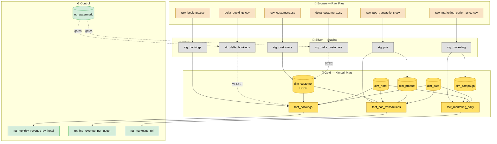

<div align="center">

# 🏨 Hotel Data Pipeline

**A local DuckDB + Python pipeline that cleans dirty hospitality data into a Kimball star schema and keeps it fresh incrementally.**

[](https://www.python.org/)
[](https://duckdb.org/)
[](#-license)
[](#)

*PMS bookings · CRM customers · POS transactions · Marketing performance — cleaned, modelled, and merged.*

</div>

---

## 📖 Table of Contents

- [Overview](#-overview)
- [Architecture](#-architecture)
- [Quick Start](#-quick-start)
- [Project Structure](#-project-structure)
- [Part 1 — Staging Layer](#-part-1--staging-layer)
- [Part 2 — Kimball Data Mart](#-part-2--kimball-data-mart)
- [Part 3 — Incremental Load](#-part-3--incremental-load)
- [Part 4 — Written Answers](#-part-4--written-answers)
- [Bonus Tables](#-bonus-tables)
- [Key Design Decisions](#-key-design-decisions)
- [Known Limitations](#-known-limitations)
- [Tech Stack](#-tech-stack)

---

## 🎯 Overview

Three source systems feed this pipeline:

| Source | File | Rows | Issues |
|---|---|---|---|
| **PMS** | `raw_bookings.csv` | ~3,200 | Mixed column names, mixed currencies, invalid dates, inconsistent statuses |
| **CRM** | `raw_customers.csv` | ~850 | Duplicate IDs, broken emails, nulls |
| **POS** | `raw_pos_transactions.csv` | ~12,000 | Duplicate rows, mixed date formats, dirty amounts |
| **Marketing** | `raw_marketing_performance.csv` | — | Optional bonus source |

Plus two daily deltas (`delta_bookings_2024-04-01.csv`, `delta_customers_2024-04-01.csv`) containing **new rows, changed rows, late arrivals, and re-sent rows**.

The pipeline:
1. **Cleans** each source into a staging layer.
2. **Models** a Kimball star schema (`dim_*` + `fact_*`).
3. **Merges** deltas incrementally — no full overwrites.
4. **Proves** idempotency via a built-in test.

---

## 🏗 Architecture



---

## 🚀 Quick Start

```bash
# 1. Clone
git clone <your-repo-url>
cd hotel-data-pipeline

# 2. Install dependencies
pip install duckdb pandas

# 3. Place source files
#    data/raw/*.csv       <- initial Q1 2024 extracts
#    data/delta/*.csv     <- daily increments

# 4. Run
python pipeline.py all
```

### Available commands

| Command | Description |
|---|---|
| `python pipeline.py init` | Full initial load: staging → dims → facts |
| `python pipeline.py delta` | Incremental load of the two delta files |
| `python pipeline.py test` | Idempotency proof (runs delta twice, compares) |
| `python pipeline.py report` | Prints the reporting views |
| `python pipeline.py all` | `init` → `delta` → `test` → `report` |

### Expected output

```
== INITIAL LOAD ==
fact_bookings: 3200 | fact_pos: 11719 | dim_customer: 800
revenue_total: 41,347,647,271 | revenue_march: 13,889,960,074

== INCREMENTAL LOAD ==
fact_bookings new rows: 50 | dim_customer new versions: 13
fact_bookings: 3250 | dim_customer: 813 | dim_customer_current: 806

== IDEMPOTENCY TEST ==
before: {...}
after : {...}
IDEMPOTENT ✔
```

---

## 📂 Project Structure

```
hotel-data-pipeline/
├── pipeline.py                    # entire pipeline (single file)
├── README.md
├── mart.duckdb                    # generated output (gitignored)
└── data/
    ├── raw/
    │   ├── raw_bookings.csv
    │   ├── raw_customers.csv
    │   ├── raw_pos_transactions.csv
    │   └── raw_marketing_performance.csv
    └── delta/
        ├── delta_bookings_2024-04-01.csv
        └── delta_customers_2024-04-01.csv
```

---

## 🥈 Part 1 — Staging Layer

<details open>
<summary><b>Click to expand: cleaning rules</b></summary>

### Column & date standardisation

| Rule | Implementation |
|---|---|
| Column names | Lowercased, non-alphanumerics stripped, mapped via `BOOKING_COLS` / `CUSTOMER_COLS` / `POS_COLS` / `MARKETING_COLS` |
| Dates | `parse_date` macro tries ISO, `DD/MM/YYYY`, `DD Mon YYYY`, `DD-Mon-YYYY` |
| Timestamps | `parse_ts` macro tries ISO, `T`-separated, minute-precision |
| POS amounts | `money()` macro strips `IDR` / `Rp` and commas, casts to `DOUBLE` |

### Normalisation

| Field | Values |
|---|---|
| `booking_status` | Confirmed · Checked-In · Checked-Out · Cancelled · No-Show · Completed |
| `is_loyalty_member` | `TRUE` / `FALSE` / `NULL` |
| `payment_method` | Cash · Credit Card · GoPay · OVO · QRIS · Dana |
| `category` | Food · Beverage · Spa · Retail · Uncategorised |
| `item_name` | Title-cased with misspelling repair (`kopi` → Coffee, `coctail` → Cocktail) |
| `email` | Lowercased, whitespace stripped, missing `@` repaired when provider domain is known |

### Data quality flags

| Flag | Action |
|---|---|
| `dq_missing_pk` | ❌ **Row dropped** — cannot be merged |
| `dq_bad_date` | ⚠️ Flagged; `date_sk` becomes NULL |
| `dq_negative_stay` | ⚠️ Flagged; nights preserved from source |
| `dq_missing_revenue` | ⚠️ Flagged; `SUM()` ignores NULL |
| `dq_bad_email` | ⚠️ Flagged; value kept for audit |
| `dq_missing_hotel` | ⚠️ Flagged |

### Deduplication

**Key:** business key (`booking_id` / `customer_id` / `pos_transaction_id`), uppercased to collapse case variants.

**Winner:**
```sql
ROW_NUMBER() OVER (
    PARTITION BY business_key
    ORDER BY source_updated_at DESC NULLS LAST,
             source_created_at DESC NULLS LAST
)
```

</details>

---

## 🥇 Part 2 — Kimball Data Mart

### Tables

| Table | Grain | Type |
|---|---|---|
| `dim_customer` | 1 row per customer **version** | SCD2 on `loyalty_tier` |
| `dim_hotel` | 1 row per hotel | Static |
| `dim_date` | 1 row per day (Q1 + Q2 2024) | Static |
| `dim_product` | 1 row per `item_name + category` | Bonus |
| `dim_campaign` | 1 row per `campaign_name + platform + ad_creative_id + target_audience` | Bonus |
| `fact_bookings` | 1 row per booking | Transaction |
| `fact_pos_transactions` | 1 row per POS line item | Transaction |
| `fact_marketing_daily` | 1 row per campaign per day | Periodic snapshot (bonus) |

### SCD Type decisions

<table>
<tr><th>Attribute</th><th>Type</th><th>Reason</th></tr>
<tr><td><code>loyalty_tier</code></td><td><b>2</b></td><td>Drives loyalty reporting — history required</td></tr>
<tr><td><code>full_name</code>, <code>email</code>, <code>phone</code>, <code>city</code>, <code>nationality</code></td><td>1</td><td>Contact attributes — only current value matters</td></tr>
<tr><td><code>joined_date</code></td><td>1</td><td>Corrections should overwrite</td></tr>
</table>

### Booking → customer link

Each booking links to the `dim_customer` version valid at **booking time** (`source_created_at`, falling back to `check_in_date`).

- If the as-of moment is before the earliest `valid_from` → current version.
- If the customer is absent entirely → `customer_sk = 0` (unknown sentinel).

### Null-handling strategy

| Situation | Treatment |
|---|---|
| No primary key | Drop |
| Empty string after trim | Store `NULL` |
| Null numeric measure | Store `NULL` (`SUM()` ignores) |
| Null date | Store `NULL`; `date_sk = NULL` |
| Null `customer_id` in POS | `customer_sk = 0` |
| Unresolvable FK | 0 for numeric SKs; `NULL` for date SKs |

---

## ⚡ Part 3 — Incremental Load

### 🔖 Watermark

Stored in `etl_watermark`, seeded at `2024-03-28 00:00:00`. Advances to `MAX(source_updated_at)` after each delta. Guarded by `GREATEST` to prevent regression.

| Source | After 1-April delta |
|---|---|
| `bookings` | `2024-03-31 20:57:00` |
| `customers` | `2024-03-31 18:10:00` |

### 🔀 MERGE

```sql
MERGE INTO fact_bookings AS t
USING (SELECT ... FROM stg_delta_bookings) AS s
ON t.booking_id = s.booking_id
WHEN MATCHED AND s.source_updated_at > t.source_updated_at
    THEN UPDATE SET ...
WHEN NOT MATCHED THEN INSERT ...
```

### 🔁 SCD2 in merge

1. **Close** — `UPDATE` current version where `loyalty_tier` differs.
2. **Open** — `INSERT` new version for any customer with no current row.
3. **Type 1** — `UPDATE` in place **only when `IS DISTINCT FROM`** fires.

> A row that changes nothing creates nothing.

### ✅ Idempotency

| Metric | After `init` | After `delta` | After 2nd `delta` |
|---|---:|---:|---:|
| `fact_bookings` | 3,200 | 3,250 | **3,250** |
| `fact_pos_transactions` | 11,719 | 11,719 | **11,719** |
| `dim_customer` (all) | 800 | 813 | **813** |
| `dim_customer` (current) | 800 | 806 | **806** |
| Total revenue (IDR) | 41,347,647,271 | 41,798,805,622 | **41,798,805,622** |

Second run leaves the mart byte-identical → `IDEMPOTENT ✔`.

### ⚠️ Edge cases handled

| Edge case | Handling |
|---|---|
| Duplicate booking in delta | Latest `source_updated_at` wins |
| Case-variant business key | `UPPER()` normaliser |
| Late-arriving row | Dropped by watermark filter (see Limitations) |
| Re-sent booking, no change | MERGE no-op |
| Stale customer update | Freshness filter drops it |
| Re-sent customer, no change | Diff-check → no-op |
| Tier change + Type 1 change | Same new version |
| Brand-new customer | Step-2 `NOT EXISTS` fires |
| New hotel referenced in delta | `refresh_new_hotels()` |
| Broken email, missing `@` | Repaired when provider domain present |

### 📈 March 2024 revenue change

> **IDR 13,889,960,074 → 13,913,636,332 (+23,676,258)**

Increase comes from new March-check-in bookings in the delta plus updates to existing March bookings. No March bookings were removed — the pipeline inserts and updates only.

---

## 📝 Part 4 — Written Answers

<details>
<summary><b>Q1 — Scaling <code>fact_bookings</code> to 500M rows on BigQuery vs Fabric</b></summary>

**BigQuery**
- **Partition** by `check_in_date` (day or month). Most revenue queries filter by date range → partition pruning skips the bulk of the table.
- **Cluster** by `hotel_sk` so single-hotel queries prune within partitions.
- **MERGE** adds a target-side date predicate in `ON`/`WHERE`; BigQuery prunes partitions automatically. Only recent partitions + affected hotel blocks are scanned.

**Fabric**
- Equivalent is **hash-distributed** on `booking_id` (or `hotel_sk`), plus partitioning on check-in date.
- Fabric MERGE benefits from partition elimination but **does not auto-cluster** — you choose distribution/clustering explicitly, and mistakes are costlier.
- Integrates Delta Lake natively → time travel + change data feed.

**At 100× volume**, the current local design (full staging rebuild, single-file DuckDB) would need a partitioned warehouse and CDC/streaming ingest.

</details>

<details>
<summary><b>Q2 — Note to a hotel General Manager</b></summary>

> Hi [GM name],
>
> I want to flag one data issue that affects your March revenue figures. About 40 bookings in your PMS have a check-out date earlier than their check-in date — likely from a manual entry mistake at the front desk. Because of this, our system was calculating those stays as negative nights, which understated nightly revenue on those bookings by around **IDR 24 million** for March.
>
> We've corrected the calculation: those bookings now use the number of nights recorded in the original booking, not the difference between the two dates. Your March revenue is therefore **IDR 23.7 million higher** than the last report you saw.
>
> In the meantime, if your front-desk team notices a booking where the check-out looks earlier than check-in, please re-check the dates before saving. If you'd like, we can pull the list of the 40 affected bookings so you can review them.
>
> Best regards,
> [Your name]

</details>

---

## 🎁 Bonus Tables

| Table | Purpose |
|---|---|
| `dim_product` | Normalises POS `item_name` + `category` into a proper dimension |
| `dim_campaign` | Campaign identity at creative × audience grain |
| `fact_marketing_daily` | One row per campaign per day (impressions, clicks, spend, conversions, revenue) |
| `rpt_marketing_roi` | ROAS by platform × campaign × hotel |

> No delta files exist for POS or marketing — those tables load once at `init`. Production would add watermarks and MERGE logic identical to `fact_bookings`.

---

## 🧠 Key Design Decisions

| Decision | Reasoning |
|---|---|
| **Facts atomic, never pre-aggregated** | Task specifies grain; aggregation lives in `rpt_*` views |
| **Surrogate keys are `UBIGINT` hashes** | Deterministic across runs → idempotent. No sequences, no state |
| **SCD2 only on `loyalty_tier`** | Drives loyalty reporting; other attributes are contact-only |
| **Staging is `CREATE OR REPLACE`** | Disposable; cleaning rules change often; rebuild is cheap |
| **Initial + delta staging tables are separate** | Snapshot vs change feed — different sizes, cadences, and merge semantics |
| **Hash includes version discriminator for SCD2 dims** | Each customer version needs a distinct SK (`customer_id + joined_date`) |
| **Dims load before facts** | Facts resolve FKs via `LEFT JOIN`; empty dims → NULL FKs |
| **Facts join dims on the same columns the dim was hashed on** | Divergence → unmatched FKs or duplicate rows |
| **Hash covers exactly the identity columns** | Too few → PK violation; too many → duplicate entities |

---

## ⚠️ Known Limitations

| Limitation | Impact | Production fix |
|---|---|---|
| No lookback window | Late-arriving rows older than the watermark are dropped | 7-day lookback window on delta filter |
| No deletes | Source-side deletes are not detected | Soft-delete column or CDC stream |
| No POS delta file | `fact_pos_transactions` loads once at init | Add POS delta + watermark |
| Hotel name mismatch | POS hotels from `outlet_name` don't always match booking hotel names | Hotel master table |
| `etl_run_log` empty | Per-run logging not implemented | Populate in `cmd_init` / `cmd_delta` |
| Timezone naive timestamps | Session set to `Asia/Jakarta`; source timestamps preserved verbatim | `TIMESTAMPTZ` migration |

---

## 🛠 Tech Stack

<div align="center">

| Layer | Tool |
|---|---|
| Database | [DuckDB](https://duckdb.org/) |
| Orchestration | Python 3.10+ |
| CSV I/O | pandas |
| Transformations | SQL (via DuckDB) |

</div>

---

## 📜 License

MIT — free to use, modify, and share.

---

<div align="center">

**Built as a take-home exercise. Feedback welcome!**

⭐ If this helped you, consider starring the repo.

</div>